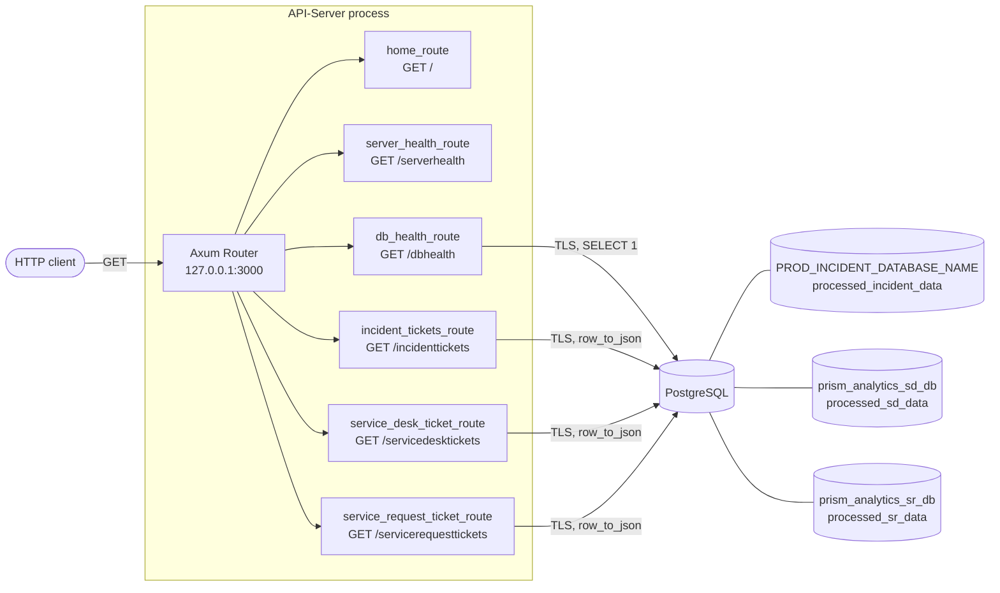
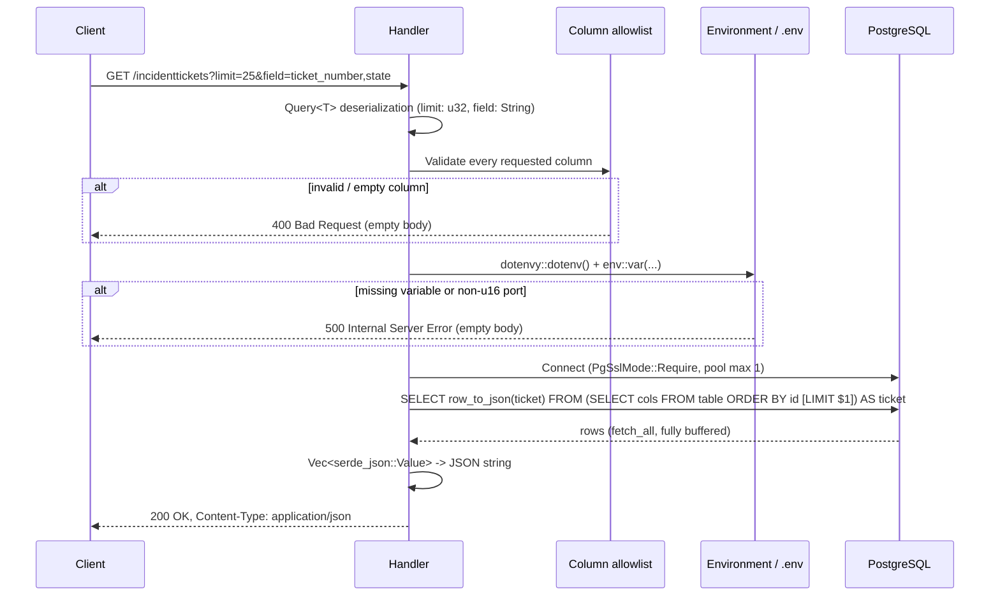

# API-Server

Asynchronous, read-only HTTP/JSON API written in Rust (Axum 0.8 on Tokio) that exposes ITSM ticket data (incidents, service desk tickets, service requests) from the Prism Analytics PostgreSQL databases, together with liveness and database-readiness probes.

| | |
| --- | --- |
| Crate / binary | `API-Server` (library-style crate name `API_Server`) |
| Version | `0.1.0` |
| Edition | Rust 2024 (requires Rust 1.85 or newer) |
| Runtime | Tokio multi-threaded (`#[tokio::main]`) |
| HTTP framework | Axum 0.8 (`http2`, `macros`, `ws` features enabled) |
| Database access | SQLx 0.9, PostgreSQL, Rustls (`tls-rustls-ring-webpki`) |
| Default listener | `127.0.0.1:3000` (hardcoded) |
| Auth | None |

> **Status: development-grade.** The service is functionally complete for its read-only scope, but it has no authentication, no TLS termination, no structured logging, no connection pooling across requests, no pagination, and no automated tests. Review [Known Limitations and Hardening Roadmap](#known-limitations-and-hardening-roadmap) before exposing it beyond localhost.

---

## Table of Contents

1. [Architecture](#architecture)
2. [Repository Layout](#repository-layout)
3. [Prerequisites](#prerequisites)
4. [Configuration](#configuration)
5. [Build and Run](#build-and-run)
6. [HTTP API Reference](#http-api-reference)
7. [Data Access Layer](#data-access-layer)
8. [Error Model](#error-model)
9. [Security Considerations](#security-considerations)
10. [Operational Characteristics](#operational-characteristics)
11. [Testing the Routes](#testing-the-routes)
12. [Development Workflow](#development-workflow)
13. [Troubleshooting](#troubleshooting)
14. [Known Limitations and Hardening Roadmap](#known-limitations-and-hardening-roadmap)
15. [Dependencies](#dependencies)

---

## Architecture

The process is a single stateless binary. `main` merges six independent `axum::Router` instances (one per controller) into one router and serves it on a Tokio `TcpListener`. There is no shared application state, no middleware layer, and no connection pool shared between requests; every database-backed request builds its own one-connection pool.



### Ticket request lifecycle



---

## Repository Layout

```text
.
├── Cargo.toml                 Package manifest and direct dependencies
├── Cargo.lock                 Resolved dependency graph (commit this; binary crate)
├── .env.example               Template for required environment variables
├── .gitignore                 Ignores /target, .env, .env.* (keeps .env.example)
├── TestRoutes.ps1             PowerShell status-code check for every route
└── src
    ├── main.rs                Router composition and TCP listener
    └── controllers
        ├── mod.rs                          Module declarations
        ├── home_route.rs                   GET /
        ├── server_health_route.rs          GET /serverhealth
        ├── db_health_route.rs              GET /dbhealth
        ├── incident_tickets_route.rs       GET /incidenttickets
        ├── service_desk_ticket_route.rs    GET /servicedesktickets
        └── service_request_ticket_route.rs GET /servicerequesttickets
```

Each controller module exposes `pub fn router() -> Router` and owns its handler, error type, environment loading, and SQL construction. The three ticket controllers are structurally identical and differ only in the column allowlist, target database, target table, and error enum name.

---

## Prerequisites

- Rust toolchain with Rust 2024 edition support (stable 1.85+), including `cargo`, `rustfmt`.
- Network reachability to the PostgreSQL server, which must accept TLS connections (the client enforces `sslmode=require`).
- PostgreSQL role with `CONNECT` on the target databases and `SELECT` on the tables listed in [Database Sources](#database-sources).
- Windows, Linux, or macOS. No system OpenSSL is needed: TLS is provided by Rustls with the `ring` backend and WebPKI roots.

```powershell
rustc --version
cargo --version
```

---

## Configuration

Configuration is read exclusively from environment variables. Every database-backed request calls `dotenvy::dotenv().ok()` first, so a `.env` file in the working directory (or a parent) is honored; real process environment variables are not overridden by `.env`.

| Variable | Required by | Description |
| --- | --- | --- |
| `PROD_DATABASE_USER` | `/dbhealth`, all ticket routes | PostgreSQL role name |
| `PROD_DATABASE_PASSWORD` | `/dbhealth`, all ticket routes | PostgreSQL password (passed as a connection field, no URL-encoding needed) |
| `PROD_DATABASE_HOST` | `/dbhealth`, all ticket routes | PostgreSQL host name or IP |
| `PROD_DATABASE_PORT` | `/dbhealth`, all ticket routes | PostgreSQL port; must parse as `u16` |
| `PROD_INCIDENT_DATABASE_NAME` | `/dbhealth`, `/incidenttickets` | Incident database name |

Setup:

```powershell
Copy-Item .env.example .env
# Edit .env, or inject the variables from your secret manager / CI environment.
```

Not configurable today (hardcoded in source):

| Setting | Value | Location |
| --- | --- | --- |
| Bind address and port | `127.0.0.1:3000` | `src/main.rs` |
| Service desk database | `prism_analytics_sd_db` | `src/controllers/service_desk_ticket_route.rs` |
| Service request database | `prism_analytics_sr_db` | `src/controllers/service_request_ticket_route.rs` |
| TLS mode | `PgSslMode::Require` | all database controllers |
| Pool size | `1` connection per request | all database controllers |

The commented `PROD_SERVICE_DESK_DATABASE_NAME`, `PROD_SERVICE_REQUEST_DATABASE_NAME`, and `PROD_MAIN_DATABASE_NAME` entries in `.env.example` are reference-only and are **not** read by the application.

**Secrets:** `.env` is git-ignored. Never commit credentials, paste them into issues, or embed them in shell history. If a real credential has ever been stored in a tracked file, treat it as compromised and rotate it.

---

## Build and Run

```powershell
cargo run                 # debug build, starts the server
cargo run --release       # optimized build
cargo build --release     # produces target\release\API-Server.exe
```

Expected startup output:

```text
Server Listening On 127.0.0.1:3000
```

Bind failures (port in use, permission denied) and serve errors currently `unwrap()` and terminate the process with a panic.

Smoke test:

```powershell
curl.exe http://127.0.0.1:3000/
curl.exe http://127.0.0.1:3000/serverhealth
curl.exe http://127.0.0.1:3000/dbhealth
```

### Hot-reload loop

```powershell
cargo install cargo-watch --locked
cargo watch -c -q -d 5 -x fmt -x check -x run
```

| Flag | Effect |
| --- | --- |
| `-c` | Clear the screen before each run |
| `-q` | Suppress Cargo Watch's own status output |
| `-d 5` | Debounce: wait 5 s after a change |
| `-x fmt -x check -x run` | Run `cargo fmt`, `cargo check`, then `cargo run` in order |

Stop any separately running instance first, otherwise the final `cargo run` fails to bind `127.0.0.1:3000`.

---

## HTTP API Reference

Base URL: `http://127.0.0.1:3000`. All routes are `GET`. Other methods on these paths return `405 Method Not Allowed`; unknown paths return `404`.

| Route | DB access | Purpose |
| --- | --- | --- |
| `GET /` | No | Reachability check |
| `GET /serverhealth` | No | Liveness probe with server timestamp |
| `GET /dbhealth` | Yes | Readiness probe for the incident database |
| `GET /incidenttickets` | Yes | Incident records |
| `GET /servicedesktickets` | Yes | Service desk records |
| `GET /servicerequesttickets` | Yes | Service request records |

### `GET /`

`200 OK`

```json
{ "status": 200, "message": "This Is Rust And AUXM Based API-Server!" }
```

The message text is the literal string in the source.

### `GET /serverhealth`

`200 OK`

```json
{ "status": 200, "message": "OK", "datetime": "2026-10-13T12:34:56.789+05:30" }
```

`datetime` is `chrono::Local::now().to_rfc3339()`, i.e. the host's local clock and UTC offset, not UTC. Suitable as a liveness probe because it has no external dependency.

### `GET /dbhealth`

Opens a TLS connection to `PROD_INCIDENT_DATABASE_NAME` using a pool capped at one connection, runs `SELECT 1`, and checks that the value equals `1`.

| Condition | Status | Body |
| --- | --- | --- |
| Any required variable missing | `500` | `{"status":500,"incidentdb":"Error"}` |
| Invalid port, connect failure, TLS failure, or query failure | `503` | `{"status":503,"incidentdb":"Error"}` |
| Healthy | `200` | `{"status":200,"incidentdb":"Ok"}` |

Use `/serverhealth` for liveness and `/dbhealth` for readiness. `/dbhealth` opens a new database connection on every call, so poll it at a conservative interval.

### Ticket endpoints

`GET /incidenttickets`, `GET /servicedesktickets`, `GET /servicerequesttickets`

**Query parameters** (both optional):

| Parameter | Type | Semantics |
| --- | --- | --- |
| `limit` | unsigned 32-bit integer | Appends `LIMIT $1` (bound parameter). Omitted defaults to 1000 rows. `limit=0` returns `[]`. A non-integer or negative value fails Axum's `Query` extraction and returns `400 Bad Request`. |
| `field` | comma-separated column names | Restricts selected columns to a subset of the endpoint's allowlist. Whitespace around names is trimmed. Omitted selects every allowlisted column. |

**Field validation:** every name must exactly match the endpoint's allowlist (case-sensitive). An unknown name, an empty item (`a,,b`, trailing comma), or an empty value (`field=`) yields `400 Bad Request` with an empty body.

**Column ordering and duplicates:**

| Endpoint | Output column order | Duplicate names in `field` |
| --- | --- | --- |
| `/incidenttickets` | As supplied by the client | Passed through to SQL unchanged |
| `/servicedesktickets` | Allowlist order | Collapsed |
| `/servicerequesttickets` | Allowlist order | Collapsed |

JSON object key order should not be relied on by consumers regardless.

**Success response:** `200 OK`, `Content-Type: application/json`, a top-level array of row objects, ordered by `id` ascending. Values retain PostgreSQL JSON typing from `row_to_json` (numbers, booleans, strings, `null`, timestamps as ISO-8601 strings).

```json
[
  { "ticket_number": "INC0000001", "state": "Resolved" },
  { "ticket_number": "INC0000002", "state": "Closed" }
]
```

**Status codes:**

| Status | Cause |
| --- | --- |
| `200` | Query succeeded (possibly an empty array) |
| `400` | Invalid `field` list, or unparsable `limit` |
| `500` | Missing env var, non-`u16` port, connection failure, query failure, or serialization failure |

**Examples:**

```powershell
curl.exe "http://127.0.0.1:3000/incidenttickets?limit=25&field=ticket_number,state"
curl.exe "http://127.0.0.1:3000/servicedesktickets?limit=10&field=ticket_number,priority,assignment_group"
curl.exe "http://127.0.0.1:3000/servicerequesttickets?limit=10&field=ticket_number,catalogue_item,state"
```

### Database Sources

| Endpoint | Database | Table | Row key used for ordering |
| --- | --- | --- | --- |
| `/dbhealth`, `/incidenttickets` | `PROD_INCIDENT_DATABASE_NAME` | `processed_incident_data` | `id` |
| `/servicedesktickets` | `prism_analytics_sd_db` | `processed_sd_data` | `id` |
| `/servicerequesttickets` | `prism_analytics_sr_db` | `processed_sr_data` | `id` |

Each table must contain an `id` column even though `id` is not in any allowlist.

### Column allowlists

<details>
<summary><code>/incidenttickets</code></summary>

```text
ticket_number, account_name, ticket_type, ticket_created_day, ticket_created_month,
ticket_created_week, ticket_created_hours, ticket_created_minutes, ticket_created_year,
ticket_created_seconds, created_at, ticket_opened_day, ticket_opened_month,
ticket_opened_year, ticket_opened_week, ticket_opened_hours, ticket_opened_minutes,
ticket_opened_seconds, opened_at, cmdb_ci, cmdb_ci_validity_status, cmdb_ci_type, state,
priority, category, channel, assignment_group, assignment_group_category,
reassignment_count, reassignment_bucket, kb_present, kb_attached, kb_referred,
attached_kb_number, referred_kb_number, kb_number, parent_ticket, assigned_to, resolved_by,
resolved_type, ticket_resolved_day, ticket_resolved_month, ticket_resolved_year,
ticket_resolved_week, ticket_resolved_hours, ticket_resolved_minutes, ticket_resolved_seconds,
resolved_at, ticket_closed_day, ticket_closed_month, ticket_closed_year, ticket_closed_week,
ticket_closed_hours, ticket_closed_minutes, ticket_closed_seconds, closed_at,
short_description, translated_short_description, description, translated_description,
work_notes, translated_work_notes, resolution_notes, translated_resolution_notes,
incident_language, keywords_1, keywords_2, normalized_keywords_1, normalized_keywords_2,
ticket_summary, automation_availability, automation_id, automation_probability,
ticket_mttr_bucket, ticket_mttr_days, ticket_mttr_hours, ticket_mttr_minutes,
ticket_mttr_seconds, ticket_aging_days, ticket_aging_hours, ticket_aging_minutes,
ticket_aging_seconds, ticket_aging_bucket, cancelled_ticket, connector_down, flapping_event,
short_duration_ticket, sequence_event, periodic_event, blank_ci, parent_child_event,
duplicate_event, deduplicate_event, correlated_event, autoheal_category, eso_analysis,
eso_category, final_category
```

</details>

<details>
<summary><code>/servicedesktickets</code></summary>

```text
ticket_number, account_name, ticket_type, created_by, ticket_created_day,
ticket_created_month, ticket_created_year, ticket_created_week, ticket_created_hours,
ticket_created_minutes, ticket_created_seconds, created_at, ticket_opened_day,
ticket_opened_month, ticket_opened_year, ticket_opened_week, ticket_opened_hours,
ticket_opened_minutes, ticket_opened_seconds, opened_at, cmdb_ci, cmdb_ci_validity_status,
cmdb_ci_type, opened_by, channel, state, priority, category, sub_category, assignment_group,
assignment_group_category, reassignment_count, reassignment_bucket, resolved_by,
resolved_type, ticket_resolved_day, ticket_resolved_month, ticket_resolved_year,
ticket_resolved_week, ticket_resolved_hours, ticket_resolved_minutes, ticket_resolved_seconds,
resolved_at, ticket_closed_day, ticket_closed_month, ticket_closed_year, ticket_closed_week,
ticket_closed_hours, ticket_closed_minutes, ticket_closed_seconds, closed_at,
short_description, translated_short_description, description, translated_description,
work_notes, translated_work_notes, resolution_notes, translated_resolution_notes,
desk_language, request_category, keywords_1, keywords_2, normalized_keywords_1,
normalized_keywords_2, ticket_summary, automation_probability, automation_availability,
automation_id, ticket_mttr_days, ticket_mttr_hours, ticket_mttr_minutes, ticket_mttr_seconds,
ticket_mttr_bucket, ticket_aging_days, ticket_aging_hours, ticket_aging_minutes,
ticket_aging_seconds, ticket_aging_bucket, kb_present, kb_attached, kb_referred,
attached_kb_number, referred_kb_number, kb_number, chat_only_ticket,
ticket_created_by_buddybot, ticket_created_by_chip, chip_zero_touch_ticket,
chip_sap_automation_ticket, chip_human_touch_ticket, cancelled_ticket, connector_down,
flapping_event, long_running_ticket, sequence_event, periodic_event, blank_ci,
parent_child_event, duplicate_event, deduplicate_event, correlated_event, eso_analysis,
eso_category, final_category
```

</details>

<details>
<summary><code>/servicerequesttickets</code></summary>

```text
ticket_number, account_name, ticket_type, ticket_created_day, ticket_created_month,
ticket_created_year, ticket_created_week, ticket_created_hours, ticket_created_minutes,
ticket_created_seconds, created_at, ticket_opened_day, ticket_opened_month,
ticket_opened_year, ticket_opened_week, ticket_opened_hours, ticket_opened_minutes,
ticket_opened_seconds, opened_at, cmdb_ci, cmdb_ci_validity_status, cmdb_ci_type,
assigned_to, catalogue_item, parent, state, priority, category, sub_category, channel,
assignment_group, assignment_group_category, request_item, reassignment_count,
reassignment_bucket, sla, sla_breached, kb_present, kb_attached, kb_referred,
attached_kb_number, referred_kb_number, kb_number, ticket_closed_day, ticket_closed_month,
ticket_closed_year, ticket_closed_week, ticket_closed_hours, ticket_closed_minutes,
ticket_closed_seconds, closed_at, ticket_resolved_day, ticket_resolved_month,
ticket_resolved_year, ticket_resolved_week, ticket_resolved_hours, ticket_resolved_minutes,
ticket_resolved_seconds, resolved_at, resolved_by, resolved_type, short_description,
translated_short_description, description, translated_description, work_notes,
translated_work_notes, resolution_notes, translated_resolution_notes, request_language,
keywords_1, keywords_2, normalized_keywords_1, normalized_keywords_2, ticket_summary,
automation_probability, automation_availability, automation_id, ticket_mttr_days,
ticket_mttr_hours, ticket_mttr_minutes, ticket_mttr_seconds, ticket_mttr_bucket,
ticket_aging_days, ticket_aging_hours, ticket_aging_minutes, ticket_aging_seconds,
ticket_aging_bucket, cancelled_request, short_duration_request, backup_check_pattern,
url_allowlist_pattern, port_opening_pattern, firewall_rule_pattern, vpn_access_pattern,
proxy_allowlist_pattern, folder_permission_pattern, parent_child_request, duplicate_request,
deduplicate_request, correlated_request, eso_analysis, eso_category, final_category
```

</details>

The allowlists are the `INCIDENT_TICKET_COLUMNS`, `SERVICE_DESK_COLUMNS`, and `SERVICE_REQUEST_COLUMNS` constants in the respective controllers. Selecting a column that is allowlisted but absent from the physical table surfaces as a `500` (query failure).

---

## Data Access Layer

### Connection handling

- Connections are built with `PgConnectOptions` (host, port, user, password, database as discrete fields), so passwords with reserved URL characters need no escaping and never appear in a connection string.
- `PgSslMode::Require` forces TLS and fails if the server does not support it. In SQLx this mode encrypts the channel but does **not** validate the server certificate chain or host name (`VerifyCa` / `VerifyFull` do).
- A new `PgPool` with `max_connections(1)` is created per request and dropped when the handler returns. This costs a full TCP + TLS + PostgreSQL authentication handshake on every request.

### SQL construction

Ticket handlers build the statement with `sqlx::QueryBuilder<Postgres>`:

```sql
SELECT row_to_json(ticket) AS ticket
FROM (
    SELECT <validated columns>
    FROM <fixed table>
    ORDER BY id
    [LIMIT $1]
) AS ticket
```

Injection controls:

- Column identifiers are interpolated only after exact-match validation against a compile-time `&'static [&str]` allowlist.
- Table and database names are constants (or an environment-provided database name used only as a connection field, never in SQL text).
- `limit` is a typed `u32` widened to `i64` and bound with `push_bind`.

### Result materialization

`fetch_all` loads every row into memory, each row is decoded as `sqlx::types::Json<serde_json::Value>`, collected into `Vec<Value>`, then serialized to a `String` and returned as the response body. Peak memory is therefore a multiple of the final payload size. Always use `limit` and `field` for large tables.

---

## Error Model

Errors are intentionally opaque to clients; no error bodies, codes, or messages are emitted, and nothing is logged.

| Source | Ticket endpoints | `/dbhealth` |
| --- | --- | --- |
| Invalid / empty `field` | `400`, empty body | n/a |
| Invalid `limit` (extractor rejection) | `400`, Axum's plain-text rejection | n/a |
| Missing environment variable | `500`, empty body | `500`, JSON body |
| Port not parseable as `u16` | `500`, empty body | `503`, JSON body |
| Connect / TLS / auth failure | `500`, empty body | `503`, JSON body |
| Query or serialization failure | `500`, empty body | `503`, JSON body |
| Listener bind or serve failure | process panic (`unwrap`) | process panic |

Because failures are not logged server-side, diagnosing a `500` today requires reproducing it against the database directly or temporarily adding logging (see the roadmap).

---

## Security Considerations

| Area | Current state |
| --- | --- |
| Authentication / authorization | **None.** Any client that can reach the socket can read all ticket data, including free-text fields such as `description` and `work_notes`, which commonly contain PII. |
| Transport security to clients | Plain HTTP. Terminate TLS at a reverse proxy or gateway. |
| Transport security to PostgreSQL | TLS required; server certificate **not** verified (`Require`). |
| SQL injection | Mitigated via allowlist + bound parameters; no user input reaches SQL text unvalidated. |
| Data mutation | None. Only `SELECT` statements are issued; additionally grant the role read-only privileges. |
| Secrets | Loaded from environment / git-ignored `.env`; not logged or returned. |
| Exposure | Bound to loopback by default, which is the only network control in place. |
| Abuse resistance | No rate limiting, request timeouts, body/response size limits, or CORS policy. An unbounded `/incidenttickets` call can exhaust memory and DB resources. |
| Database role | Use a dedicated least-privilege read-only role scoped to the three databases and tables. |

---

## Operational Characteristics

- **Concurrency:** Tokio multi-thread scheduler; handlers are fully async. Concurrent database requests each open a separate PostgreSQL connection, so concurrency is bounded by the server's `max_connections`.
- **Statelessness:** No in-memory state; safe to run multiple instances behind a load balancer.
- **Latency:** Dominated by per-request connection setup (TCP + TLS + auth) plus full-result buffering.
- **Config reload:** `.env` is re-read on each database request, so edits take effect without a restart (process environment variables still take precedence).
- **Observability:** Only the startup `println!`. No tracing, metrics, or access logs.
- **Shutdown:** No graceful-shutdown handler; in-flight requests are dropped on process termination.
- **Time:** `/serverhealth` reports host-local time, so it varies with host timezone configuration.
- **Binding:** `127.0.0.1` is unreachable from other hosts and from outside a container's network namespace; change `src/main.rs` to bind `0.0.0.0` (behind appropriate controls) for containerized deployment.

---

## Testing the Routes

Start the server first (`cargo run`) in one terminal, then run the commands below from a second PowerShell terminal. Use `curl.exe` (not the `curl` alias, which maps to `Invoke-WebRequest` in Windows PowerShell) and always quote URLs containing `&`.

```powershell
$base = "http://127.0.0.1:3000"
```

### 1. Routes with no database dependency

```powershell
curl.exe -i "$base/"
curl.exe -i "$base/serverhealth"
```

Expected: `HTTP/1.1 200 OK` with `content-type: application/json`.

```json
{"status":200,"message":"This Is Rust And AUXM Based API-Server!"}
{"status":200,"message":"OK","datetime":"2026-10-13T12:34:56.789+05:30"}
```

### 2. Database health

```powershell
curl.exe -i "$base/dbhealth"
```

| Result | Meaning |
| --- | --- |
| `200` `{"status":200,"incidentdb":"Ok"}` | Env vars valid, TLS connection and `SELECT 1` succeeded |
| `503` `{"status":503,"incidentdb":"Error"}` | Connection, credentials, TLS, port, or database problem |
| `500` `{"status":500,"incidentdb":"Error"}` | A required environment variable is missing |

### 3. Ticket routes (happy path)

```powershell
# Smallest useful call: 1 row, 2 columns
curl.exe -i "$base/incidenttickets?limit=1&field=ticket_number,state"
curl.exe -i "$base/servicedesktickets?limit=1&field=ticket_number,priority"
curl.exe -i "$base/servicerequesttickets?limit=1&field=ticket_number,catalogue_item"

# Several columns, 25 rows
curl.exe -s "$base/incidenttickets?limit=25&field=ticket_number,state,priority,assignment_group"

# Whitespace around names is trimmed (URL-encoded space)
curl.exe -s "$base/incidenttickets?limit=3&field=ticket_number,%20state"

# All allowlisted columns, still capped
curl.exe -s "$base/servicedesktickets?limit=5"

# limit=0 is valid and returns an empty array
curl.exe -s "$base/incidenttickets?limit=0&field=ticket_number"
```

Expected for the first command: `200 OK`, `content-type: application/json`, and a body such as `[{"ticket_number":"INC0000001","state":"Resolved"}]`. `limit=0` returns `[]`.

Avoid calling a ticket route without `limit` against a large table; the full result set is buffered in memory.

### 4. Negative and edge cases

These do not require valid ticket data for the `400` cases, because validation runs before the database is contacted.

```powershell
# Unknown column -> 400
curl.exe -i "$base/incidenttickets?field=not_a_column"

# Empty value -> 400
curl.exe -i "$base/incidenttickets?field="

# Empty item (double comma) -> 400
curl.exe -i "$base/servicedesktickets?field=ticket_number,,state"

# Column from a different endpoint's allowlist -> 400
curl.exe -i "$base/incidenttickets?field=catalogue_item"

# SQL injection attempt is rejected by the allowlist -> 400
curl.exe -i "$base/incidenttickets?field=ticket_number%3B%20DROP%20TABLE%20processed_incident_data"

# Non-numeric, negative, or out-of-range limit -> 400 (Axum Query rejection)
curl.exe -i "$base/incidenttickets?limit=abc"
curl.exe -i "$base/incidenttickets?limit=-1"
curl.exe -i "$base/incidenttickets?limit=4294967296"

# Unsupported method -> 405
curl.exe -i -X POST "$base/"

# Unknown path -> 404
curl.exe -i "$base/nope"
```

### 5. Failure-mode checks (optional)

```powershell
# Missing configuration: start the server from a directory without .env and with the
# PROD_* variables unset. /dbhealth -> 500, ticket routes -> 500.

# Unreachable database: set PROD_DATABASE_PORT=1 (or a wrong host).
# /dbhealth -> 503, ticket routes -> 500.

# Invalid port: set PROD_DATABASE_PORT=abc.
# /dbhealth -> 503, ticket routes -> 500.
```

Restart the server after changing process environment variables; values in `.env` are re-read per request, but real environment variables take precedence over them.

### 6. Run every route in one script

Save as `scripts\smoke-test.ps1` (not included in the repository) and run with `powershell -File scripts\smoke-test.ps1`. It prints the HTTP status for each case and exits non-zero on any mismatch. The repository already includes `TestRoutes.ps1`, which performs a similar check; run it with `.\TestRoutes.ps1` while the server is running.

```powershell
$base = if ($env:API_BASE) { $env:API_BASE } else { "http://127.0.0.1:3000" }

# Format: expected status, URL path and query
$cases = @(
    @(200, "/"),
    @(200, "/serverhealth"),
    @(200, "/dbhealth"),
    @(200, "/incidenttickets?limit=1&field=ticket_number,state"),
    @(200, "/servicedesktickets?limit=1&field=ticket_number,priority"),
    @(200, "/servicerequesttickets?limit=1&field=ticket_number,catalogue_item"),
    @(200, "/incidenttickets?limit=0&field=ticket_number"),
    @(400, "/incidenttickets?field=not_a_column"),
    @(400, "/incidenttickets?field="),
    @(400, "/servicedesktickets?field=ticket_number,,state"),
    @(400, "/servicerequesttickets?field=ticket_number%3B%20DROP%20TABLE%20x"),
    @(400, "/incidenttickets?limit=abc"),
    @(400, "/servicedesktickets?limit=-1"),
    @(404, "/nope")
)

$failed = 0
foreach ($case in $cases) {
    $expected, $path = $case
    $actual = [int](curl.exe -s -o NUL -w "%{http_code}" "$base$path")
    $ok = $actual -eq $expected
    if (-not $ok) { $failed++ }
    "{0,-4} expected={1} actual={2}  {3}" -f $(if ($ok) { "PASS" } else { "FAIL" }), $expected, $actual, $path
}

if ($failed -gt 0) { Write-Error "$failed case(s) failed"; exit 1 }
```

The `200` database-backed cases pass only when valid `PROD_*` credentials are configured and the target tables exist.

### 7. Rust tests (sample, not yet in the repository)

**Unit test for column validation.** Add at the bottom of `src/controllers/incident_tickets_route.rs` (the same pattern applies to the service desk and service request controllers):

```rust
#[cfg(test)]
mod tests {
    use super::*;

    #[test]
    fn all_columns_when_field_is_absent() {
        let columns = selected_columns(None).unwrap();
        assert!(columns.contains("ticket_number"));
        assert!(columns.contains("final_category"));
    }

    #[test]
    fn accepts_valid_subset_and_trims_whitespace() {
        let columns = selected_columns(Some("ticket_number, state")).unwrap();
        assert!(columns.contains("ticket_number"));
        assert!(columns.contains("state"));
    }

    #[test]
    fn rejects_unknown_empty_and_injected_columns() {
        for field in ["bogus", "", "ticket_number,,state", "state; DROP TABLE x"] {
            assert!(
                matches!(selected_columns(Some(field)), Err(IncidentTicketsError::InvalidField)),
                "expected rejection for {field:?}"
            );
        }
    }
}
```

**In-process router test (no network, no database).** Add dev-dependencies:

```toml
[dev-dependencies]
tower = { version = "0.5", features = ["util"] }
http-body-util = "0.1"
```

Add to `src/controllers/home_route.rs`:

```rust
#[cfg(test)]
mod tests {
    use super::*;
    use axum::{body::Body, http::Request};
    use http_body_util::BodyExt;
    use tower::ServiceExt;

    #[tokio::test]
    async fn root_returns_200_json() {
        let response = router()
            .oneshot(Request::get("/").body(Body::empty()).unwrap())
            .await
            .unwrap();
        assert_eq!(response.status(), StatusCode::OK);

        let bytes = response.into_body().collect().await.unwrap().to_bytes();
        let json: serde_json::Value = serde_json::from_slice(&bytes).unwrap();
        assert_eq!(json["status"], 200);
    }
}
```

The same `oneshot` approach covers `/serverhealth` and the `400` paths of the ticket routes (for example `?field=bogus`), since those return before any database access. Database-backed `200` paths need a reachable PostgreSQL instance and are better suited to integration tests against a seeded container.

Run the tests:

```powershell
cargo test
```

---

## Development Workflow

```powershell
cargo fmt -- --check       # formatting
cargo check                # type-check
cargo clippy --all-targets -- -D warnings   # lint (requires clippy component)
cargo test                 # no tests exist yet; verifies the test build only
```

Adding an endpoint:

1. Create `src/controllers/<name>_route.rs` exposing `pub fn router() -> Router`.
2. Declare it in `src/controllers/mod.rs`.
3. Merge it in `src/main.rs` with `.merge(controllers::<name>_route::router())`.

Suggested test strategy (not yet implemented): unit-test `selected_columns` for allowlist enforcement, ordering, and empty-item rejection; exercise routers in-process with `tower::ServiceExt::oneshot`; run integration tests against a disposable PostgreSQL container seeded with the three tables.

---

## Troubleshooting

| Symptom | Likely cause | Action |
| --- | --- | --- |
| Panic `Address already in use` on startup | Another process (or `cargo watch` instance) holds port 3000 | Stop it, or change the bind address in `src/main.rs` |
| `/dbhealth` returns `500` | A required environment variable is unset | Verify `.env` location (working directory) and all five variables |
| `/dbhealth` returns `503` | Bad port value, DNS/network failure, server without TLS, wrong credentials, or missing database | Test with `psql "sslmode=require host=... port=... dbname=... user=..."` |
| Ticket endpoint returns `400` | Unknown/empty column in `field`, or non-integer `limit` | Compare names against the allowlist (case-sensitive) |
| Ticket endpoint returns `500` | Config/DB failure, missing `id` column, or allowlisted column absent from the table | Run the equivalent `SELECT` manually; check table schema |
| Very slow or memory-heavy response | No `limit`, all columns selected, large text columns | Add `limit` and a narrow `field` list |
| `cargo` reports unknown edition `2024` | Toolchain too old | `rustup update stable` |

---

## Known Limitations and Hardening Roadmap

Priority order for production readiness:

1. **Authentication and authorization** (API keys, JWT/OIDC via a `tower` layer, or enforce at a gateway).
2. **Shared `PgPool`** held in Axum `State`, created once at startup with explicit `acquire_timeout`, `idle_timeout`, and sensible `max_connections`; remove per-request `dotenvy::dotenv()` and duplicated `DatabaseConfig` structs by centralizing configuration in one module loaded at boot (fail fast on missing variables).
3. **Certificate verification:** switch to `PgSslMode::VerifyFull` with a configured root CA.
4. **Pagination and streaming:** replace unbounded `fetch_all` with keyset/offset pagination and a server-side maximum `limit`; consider streaming (`fetch` + chunked body).
5. **Observability:** adopt `tracing` / `tower-http::trace`, structured logs with request IDs, and Prometheus/OpenTelemetry metrics; log the underlying error before mapping to `500`.
6. **Error contract:** return a consistent JSON error envelope (`{ "error": { "code", "message" } }`).
7. **Resilience:** `tower` timeout, concurrency-limit, and rate-limit layers; graceful shutdown via `axum::serve(...).with_graceful_shutdown(...)`.
8. **Configuration:** make bind address, port, and all database names environment-driven.
9. **Code reuse:** collapse the three near-identical ticket controllers into one generic implementation parameterized by (database, table, allowlist).
10. **Testing and CI:** unit and integration tests, `cargo fmt --check`, `clippy -D warnings`, `cargo audit`/`cargo deny`, release builds, and a container image.
11. **Cleanup:** remove unused Axum `ws` feature, add `/` and health-check semantics to the API spec (OpenAPI), and correct the spelling of the root-route message if unintentional.

---

## Dependencies

Direct dependencies from `Cargo.toml`:

| Crate | Version | Features | Role |
| --- | --- | --- | --- |
| `tokio` | 1.53.2 | `full` | Async runtime, `TcpListener` |
| `axum` | 0.8.9 | `http2`, `macros`, `ws` | Routing, extractors, responses |
| `serde` | 1.0.229 | `derive` | Query and response (de)serialization |
| `serde_json` | 1.0.154 | default | Dynamic JSON values for row data |
| `chrono` | 0.4.45 | `clock` | Local timestamp for `/serverhealth` |
| `dotenvy` | 0.15.7 | default | `.env` loading |
| `sqlx` | 0.9.0 | `runtime-tokio`, `tls-rustls-ring-webpki`, `postgres`, `json` (default features disabled) | PostgreSQL driver, query builder |

Exact transitive versions are pinned in `Cargo.lock`. Audit periodically with `cargo audit` or `cargo deny check`.
